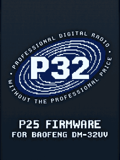
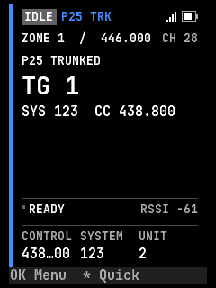
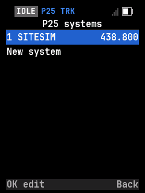
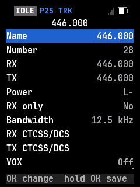

<!-- SPDX-License-Identifier: MIT -->

# P32Firmware

**Professional Digital Radio, Without The Professional Price.**

P32Firmware is free, MIT-licensed firmware for the **Baofeng DM-32UV**. It adds P25 Phase 1 conventional and trunked
voice, control-channel monitoring and a purpose-built instrument UI to an affordable handheld, while keeping analog FM
and the radio's existing hardware useful.

P32Firmware is experimental. It is under active development: keep a backup, and expect incomplete or changing
behavior.

### [p32firmware.com](https://p32firmware.com)

Use the [web installer](https://p32firmware.com/install/) in Chrome or Edge to install, update, back up and restore
the radio from the browser. Nothing is uploaded; the firmware image is checked before it is written.

**[Install](https://p32firmware.com/install/)** · **[Screenshots](https://p32firmware.com/screenshots/)** ·
**[Features](https://p32firmware.com/features/)** · **[Source](https://github.com/SarahRoseLives/P32)** ·
**[Donate](https://sarahsforge.dev/products/donation)**

<p>




</p>

## Radios and status

| Radio | Platform | Display | Status |
|---|---|---|---|
| Baofeng DM-32UV | HR_C7000 (C-SKY) | 240x320 color | Experimental; supported |

P32Firmware targets the DM-32UV only. There is one board under `boards/dm32/`.

## Features

| Feature | What it does |
|---|---|
| **P25 Phase 1 voice** | Conventional and trunked voice, including talkgroup calls |
| **P25 trunking** | Control-channel receive, system/site information, affiliation, call grants and voice-channel follow |
| **Control-channel monitor** | NAC, WACN, system, RFSS/site, talkgroup and voice-channel details |
| **Analog FM** | CTCSS/DCS, scan, VFO and dual watch |
| **Instrument UI** | 240x320 color display with trunk status, signal bars and control-channel details |
| **Web installer** | Install, update, back up and restore over the programming cable, with a fixed release image |
| **Themes and accessibility** | Light/dark themes, large text and high-contrast modes |
| **Crash log** | On-radio crash records for troubleshooting |

P25 Phase 1 is the current focus. The P25 codeplug editor is available at
[p32firmware.com/codeplug](https://p32firmware.com/codeplug/): it edits channels, zones and P25 systems in the browser.
Firmware installation and backups remain available in the web flasher.

## Hardware

| Part | DM-32UV |
|---|---|
| MCU | HR_C7000 (C-SKY CK803S) |
| RF | FD6818 |
| Display | ST7789, 240x320 color |
| Programming | USB-serial programming cable; the radio has no USB port of its own |

## Install

1. Download the current release from the [web installer](https://p32firmware.com/install/).
2. Put the DM-32UV in update mode as the installer instructs.
3. Back up the radio when offered.
4. Install and let the write finish without disconnecting the cable.

The installer never writes the bootloader. If an installation stops partway, put the radio back in update mode and
install again.

## Build

The DM-32UV uses the C-SKY toolchain. You need `make`, Python 3.11 or later and `csky-elf-gcc` on `PATH` or in
`~/toolchains/csky-elf/bin/`. Build the compiler with `tools/build-csky-toolchain.sh`, or use the Docker image in
`tools/docker/csky-toolchain/`.

```sh
make BOARD=dm32                 # build/dm32/rfoundry_dm32.bin
make -C tests/host              # host tests
site/tests/run.sh               # web installer tests
JOBS=8 tools/ci.sh              # everything CI checks
```

Package a release image for the web installer:

```sh
VERSION=v26.11
make BOARD=dm32 RELEASE="$VERSION"
python3 tools/release.py --board dm32 --version "$VERSION" --out build/dist
```

The site and its embedded firmware are documented in [UPDATING.md](UPDATING.md).

## Documentation

| | |
|---|---|
| [UPDATING.md](UPDATING.md) | Build, test and deploy the website and the firmware it installs |
| [docs/dev/building.md](docs/dev/building.md) | Toolchains, make targets and flashing |
| [docs/dev/architecture.md](docs/dev/architecture.md) | Core, HAL, platform and board layers |
| [docs/spec/](docs/spec/) | Hardware, protocols and behavior |
| [docs/CLEANROOM.md](docs/CLEANROOM.md) | The clean-room rules |

## Testing

| Level | What it covers |
|---|---|
| Host unit tests | Individual encoders, decoders, state machines and settings |
| Software in the loop | Real firmware code on the host with simulated radio hardware |
| UI simulator | Screen layouts, menu flows and the screenshots in `docs/ux/screens/` |
| Web flasher tests | The browser installer against generated firmware fixtures |

Run the host tests with `make -C tests/host`; run `site/tests/run.sh` for the flasher. Hardware-in-the-loop tests need a
radio and are skipped without one.

## Contributing

Issues and pull requests are welcome. Read [docs/CLEANROOM.md](docs/CLEANROOM.md) first. Keep radio-independent code in
`core/`, board wiring in `boards/`, and anything that costs flash behind a `CONFIG_` switch. New behavior needs a test,
and changes to user-facing text need the site and firmware translations updated. Run `tools/ci.sh` before opening a
pull request.

## License

P32Firmware is MIT licensed; see [LICENSE](LICENSE). Third-party components keep their own permissive licenses in
[LICENSES/](LICENSES/).

## Layout

| Path | What |
|---|---|
| `core/` | Radio-independent code: P25, FM, UI, radio state, settings, CPS and the debug link |
| `hal/` | Interfaces and the `board_t` descriptor |
| `drivers/` | Shared chip drivers |
| `platform/` | SoC startup, clocks, interrupts and RTOS glue (`hrc7000`) |
| `boards/dm32/` | The DM-32UV board, boot splash, pins, display, flash and linker script |
| `config/` | Build-time feature switches |
| `third_party/` | Permissively licensed upstream code as submodules |
| `tools/` | Flashing, release packaging, codec tools, CI and bench tools |
| `tests/host/` | Unit, software-in-the-loop and UI simulator tests |
| `tests/hil/` | Hardware-in-the-loop tests; need a radio and the SDR bench |
| `site/` | The p32firmware.com site and web installer |
| `web/` | The Go server that embeds and serves `site/` |
| `deploy/` | The server service and deployment script |
